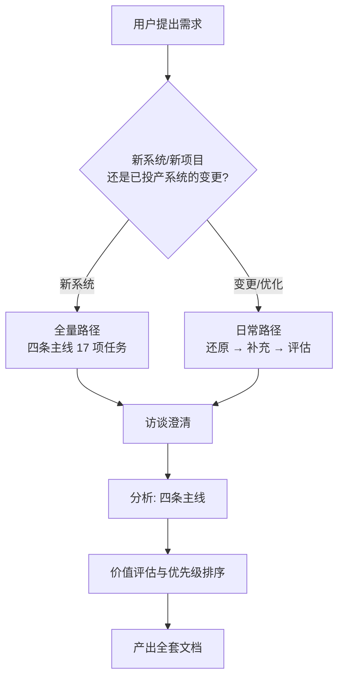

# 有效需求分析

面向 **B 端系统**产品经理的需求分析方法与工具集：把一句含糊的业务诉求，变成一整套可追溯、可评审、可开发的需求文档。

**核心原理：需求 = 预期 − 现状。** 用户提出来的永远是"方案级需求"（加个页面、加个筛选、支持导出）。需求分析要做的是绕过方案，还原出"问题级需求"（谁、在什么业务场景下、受什么影响、损失什么），再由分析人员提出成本更合适的解决方案。

**我们才是解决方案专家，客户只是问题专家。**

产出不是一个文档，而是一整套文档：价值需求 / 功能需求 / 数据需求 / 非功能需求四条主线，外加业务规则与约束。

---

## 铁律：先访谈，后分析

**在收到用户对第一轮问题的答复之前，只能产出两份文件：《需求澄清问题清单》和《访谈记录与假设登记册》。其他任何需求产物都不得写出。**

这不是流程仪式。没有访谈，问题级需求只能靠猜；猜错的部分会以"已确认需求"的形态混进文档，后期无法追溯、无法返工、无法验证。

### 阶段闸门表

| 阶段 | 允许产出 | 禁止产出 |
|---|---|---|
| **G0 尚未提问** | 《需求澄清问题清单》《访谈记录与假设登记册》 | 任何其他文件 |
| **G1 已提问、未收到答复** | 同上两份，可追加新问题（`Q-xx`） | 问题卡片、干系人档案、流程、场景、模型、功能清单、SRS —— **包括标着"分析底稿""初稿""供讨论"的** |
| **G2 已收到第一轮答复** | 按已确认事实补全《访谈记录》；分析底稿可写，但其中每一条须标 `A-xx` 或 `S-xx` | 未标注来源的结论 |
| **G3 澄清完成** | 全套产物（见 `references/artifacts.md`） | —— |

**G2 → G3 无需等待全部问题答完。** 进入 G2 即可产出全套产物，未获答复的问题对应内容**保留 `S-xx` 标注**，一路带到验收标准与测试用例。等待"全部答完"是不现实的，那等于永不产出。

**进入 G2 的门槛：核心问题必须已获答复** —— Who（谁的需求）、Why（什么问题）、现状（现在怎么应对）、频率（多久一次）以及必答三问，至少答完其中 5 项。仅凭一条边缘问题（如"上线要到什么时候"）的答复不足以推闸。

**部分答复不豁免下游标注。** 闸门推进后，**未获答复的 `Q-xx` 所对应的内容一律保留 `S-xx` 标注**，不因闸门已开就默认升为 `A-xx`。下游功能需求引用未确认信息时，标注必须一路带到验收标准与测试用例。

**`S-xx` 只能记"我们相信什么、怎么验证、验证不成立会怎样"，不能记分析结论。** 写 `S-03`"审批可能是单级审批"可以（它可验证、有后果）；写 `S-03`"审批流应设计为单级节点，状态机含草稿/待审/通过/驳回四态"不行（那是流程分析结论，属于 G2/G3 产物）。判据：**这条 `S-xx` 的答案是"是/否"还是"一套结构"？** 是"是/否" → 留在 `S-xx`；是一套结构 → 它是分析结论，不能出现在 G1。

**"分析底稿""初稿""假设版""供讨论用"不是绕过 G1 的后门。** G1 阶段写出的任何问题卡片、流程、场景、模型，都会与正式产物混为一谈：用户分不清哪条是已确认的、哪条是猜的，评审时也无法定向核实。

**闸门管的是内容，不是文件数量。** 把问题卡片、流程图、领域模型、功能清单塞进《访谈记录与假设登记册》的"附录"或"表格"里，形式上仍是两份文件，实质上已污染 —— 闸门照样失败。G1 阶段的两份文件里**只允许**出现：问题本身、用户已答复的内容、编号化的假设与其验证计划、术语定义。**不允许出现任何分析结论**（不写流程、不写场景、不写模型、不写功能、不写"该系统应包含…"）。

**换标题躲不掉。** 脚本查的是内容形态，不是标题措辞：把"功能清单"改叫"附：本次要做的"，把流程表改叫"访谈要点"，只要表头出现"步骤/责任人/模块"、或者出现 `FP-01`/`D-01` 这类越界编号、或者正文留下"该系统应包含…"的断言、或者干脆列一串无编号的功能条目，都会被抓出来。**判断依据是这些内容本身是不是分析结论，不是它被放在了哪个标题下面。**

**G1 → G2 的分界是"用户对问题的答复"，不是"用户说了什么"。** 用户在需求里附带的信息（"就这三块""两周上线"）记为 `A-xx`（来源：用户原话），但**不构成闸门推进** —— 用户没有回答任何一个 `Q-xx`，就没有答复。

用户催稿时的正确交付物是**《需求澄清问题清单》**——它本身就是可评审、可勾选、可批量回答的产物。给出 8 个有抓手的问题，好过给出 100 条猜测的需求。

访谈记录用固定编号，便于后续追溯：

| 前缀 | 含义 |
|---|---|
| `Q-xx` | 已提出的问题，等待答复 |
| `A-xx` | 用户已确认的事实 |
| `S-xx` | 分析方假设 —— 必须同时写明验证方式、不成立的后果（两列缺一不可，空着等于没写） |
| `T-xx` | 业务术语定义（歧义术语必须澄清） |

**访谈在对话里进行，不只在文件里。** 把 `Q-xx` 直接问在回复中，让用户当场回答 —— 有提问工具就用提问工具，一次问 2–4 个最关键的，其余留作文件里的批量清单。文件是记录与留痕，对话是访谈本身；只写文件不提问，等于把访谈推给了用户自己完成。

**结构性约束：每一行进入分析文档的需求，都必须引用至少一个 `A-xx`；无 `A-xx` 支撑的条目必须显式标注 `S-xx`。** 分析文档里出现没有来源的条目，就是把假设伪装成了事实。

### 编号前缀登记表

**每个前缀在一个系统内全局唯一，不得复用。** 开工时先登记本系统使用的全部前缀，写进《访谈记录与假设登记册》，避免同一前缀在两份产物里指代不同事物。

| 前缀 | 含义 | 归属产物 |
|---|---|---|
| `Q-xx` | 待答复的问题 | 问题清单 |
| `A-xx` | 已确认事实 | 访谈记录（**全项目唯一定义处**） |
| `S-xx` | 分析方假设 | 访谈记录（**全项目唯一定义处**） |
| `T-xx` | 术语定义 | 访谈记录 |
| `PC-xx` | 问题卡片 | 问题卡片 |
| `SD-xx` / `SP-xx` | 干系人 / 阻力点 | 干系人档案 |
| `CP-xx` | 管控点 | 管控点分析 |
| `FP-xx` | 业务流程 | 业务流程列表 |
| `US-xx` | 业务场景 | 业务场景描述 |
| `BR-xx` | 业务规则 | 业务规则描述 |
| `DC-xx` | 领域类 | 领域模型 |
| `QS-xx` | 质量场景 | 质量场景决策卡 |
| `MR-xx` | 维护场景 | 维护需求描述 |
| `C-xx` | 约束 | 约束描述 |
| `F-xx` | 功能需求 | 功能需求清单 |
| `NFR-xx` | 非功能需求 | 质量需求 |
| `AC-xx` | 验收标准 | 验收标准 |

若某个前缀已被占用，改用别的（如 `RN-xx` 给阻力点、`RSK-xx` 给风险），**不要复用**。

**同一批前缀成组使用，构成一个「编号族系」。** 族系之间不得共用前缀。典型：`M/V/S/G` 是业务流程族，`Q/A/S/T` 是访谈族，`F/N/BR/QS/PC` 是需求族。

> 撞号的典型形态：`S-xx` 在《访谈记录》里是"分析方假设"，在《业务流程列表》里又变成"支撑类流程"—— 同一个编号在两套不相干的族系里指代两件事，读者无法判断 `S-02` 到底是哪个。**这是真错，不是风格问题。**
>
> 与之相对，**同一编号在多份产物里出现本身不是问题**：SRS 摘录、优先级评估索引、变更分析表都会复述上游编号，那是**引用**。引用允许用简称（如"预约与占用同事务"）、允许换措辞，但不得改变所指。

**族系怎么判定 —— 看编号"待在哪一栏"，不看它叫什么名字。** 脚本按每条记录**所属的栏目/章节**来定它属于哪个族系：

- 表格里的记录 → 看它落在哪一列（该列表头的语义：假设 / 术语 / 事实 / 流程 / 规则 / 场景 / 需求 / 优先级 / 追溯 …）
- 标题、列表里的记录 → 看它属于哪个**上级章节**（标题下的语义角色）

**不能拿条目自己的名字定族系。** 例如 `### Q-05（频率与场景规律）` 里的"场景"是这条问题的**名字**，不是栏目 —— 拿它定族系，会把访谈族的问题误判成场景族，报出一堆假撞号。

**脚本会把"撞号"和"引用"分开：**

- 同一前缀在**两套不相干的族系**里指代两件事 → **报错**（真错）
- 同一编号在多份产物里出现、但都在同一族系内 → **不报错**；若措辞不同 → **提示**（引用可以换措辞，但不能改所指）
- 汇总型产物（《需求规格说明书》《需求优先级评估》《变更分析表》）的编号是复述上游的引用 → 豁免族系冲突判定

自检脚本 `scripts/check_artifacts.py` 会把这两类分开：族系不相交 → 报错；同族系内措辞不一致 → 提示。

**每个阶段都要跑一次自检，用对应阶段的参数**（阶段不同，检查项不同）：

```bash
# G1：只允许两份文件，且这两份文件里不得含分析结论
python3 scripts/check_artifacts.py <产物目录> --stage G1

# G2：编号闭合 + 溯源 + S-xx 合规（分析底稿阶段，允许写底稿但要求标注来源）
python3 scripts/check_artifacts.py <产物目录> --stage G2

# G3：全部检查（加前缀撞号、措辞一致性）
python3 scripts/check_artifacts.py <产物目录> --stage G3
```

| 参数 | 检查内容 |
|---|---|
| `--stage G1` | 目录里只允许《需求澄清问题清单》与《访谈记录与假设登记册》各一份；同名文件重复 → 报错。**两份文件的内容也要干净**，命中以下任一即报错：① 标题出现"业务流程/领域模型/功能需求/问题卡片"等分析产物名；② 表头出现"流程/场景/模块/步骤/责任人"等分析结论特征词；③ 出现 `Q/A/S/T` 之外的前缀编号（`FP-01`/`US-01`/`D-01`…，定义或引用都算）；④ 正文出现"该系统应包含…"这类强断言；⑤ 代码块里画流程图（mermaid 等）；⑥ 出现无编号的清单式条目（功能/能力清单） |
| `--stage G2` | 编号闭合（无悬空引用）、溯源完整（`F-xx`/`NFR-xx`/`AC-xx`/`MR-xx` 须带 `A-xx`/`S-xx`）、`S-xx` 纯度（不得含结构化分析结论）、`S-xx` 登记表两列（验证方式 / 验证不成立的后果）存在且非空、前缀撞号（按语义角色判族系） |
| `--stage G3` | G2 全部 + 措辞一致性提示 |

> **溯源只覆盖"需求条目"**（`F-xx`/`NFR-xx`/`AC-xx`/`MR-xx`）。`BR-xx` 业务规则、`US-xx` 业务场景、`PC-xx` 问题卡片、`CP-xx` 管控点、`QS-xx` 质量场景属于**分析产物** —— 它们引用上游事实或分析结论即可，不要求直达 `A-xx`，否则会把"经分析推出的业务规则"错判成溯源缺失。

**`--stage G1` 是闸门自检，不是事后补查。** 每次写完第一轮问题就应当跑一次 —— 它能在你把分析结论混进登记册的当下就报出来，而不是等到 G3 才发现污染已扩散到下游。

**`S-xx` 登记表的两列不是装饰。** 脚本会逐条检查：`验证方式` 与 `验证不成立的后果`两列必须存在，且每条 `S-xx` 都填了内容（状态为"已关闭"时允许后果写 `—`）。空着就等于没写。

**第一轮只问 5–8 个问题**，不要一次抛出 30 个。提问库见 `references/interview-playbook.md`。

**每个问题必须合格**（三条同时满足）：

1. **有抓手** —— 用户能凭记忆或记录直接回答，不需回忆模糊的意图。"哪些业务需要改进？"不合格；"过去一两个月，哪一次xxx让你最烦？说一件具体的事"合格。
2. **带为什么** —— 写明问这个是为了确认什么，避免用户觉得被审问。
3. **可记录** —— 答案能直接落成一条 `A-xx`，或落成一个具体的 `S-xx` 验证项。

数量与质量都要守：8 个合格问题胜过 30 个抽象问题。宁可少问，不要凑数。

提问之外，先建好《访谈记录与假设登记册》：把已确认事实记为 `A-xx`，把分析方的推断记为 `S-xx`（必须同时写明验证方式、不成立的后果），把歧义术语记为 `T-xx`，待答复的问题记为 `Q-xx`。

---

## 流程



### 阶段 1 — 还原需求（访谈）

澄清 **Who / Why / How** 三要素：用**过去时**问出"谁"的"什么问题"；了解当前如何应对（现状）与业务环境；然后由分析方提出解决方案供用户确认。

必答三问：①提出者与使用者是否一致 ②是否涉及潜在影响者 ③是否能代表主流用户的声音。

提问技巧库（表象原因决策提问法、分而治之提问法、同类问题横推、关联行为纵推、360 度分析法）见 `references/interview-playbook.md`。

### 阶段 2 — 补充需求

只挖掘问题，不挖掘方案。三个角度：同类问题横推（从 Why 提炼"问题类型"）、关联行为纵推（该场景的前中后关联行为要支持吗）、360 度分析法（上下游、管理者、协作者）。

### 阶段 3 — 分析

按四条主线展开，17 项关键任务及其剪裁条件见 `references/task-playbook.md`：

- **价值需求**：目标/愿景分析 → 干系人识别 → 干系人分析（含阻力点）
- **功能需求**：业务支持（业务流程 → 业务场景 → 场景分析）/ 管理支持（管控点 → 业务报表）/ 维护支持
- **数据需求**：领域建模（范围与关系）→ 业务数据分析（构成与推演）
- **非功能需求**：识别并排序关键质量属性 → 识别质量场景（逆向思考 + 场景化思考）

每条主线都可剪裁，但**价值需求主线与功能需求主线几乎不可剪裁**。

### 阶段 4 — 价值评估

选一个主评估维度（0→1 建设期用业务维，1→10 发展期用用户维与竞争维，10→100 成熟期用运营维），逐条评估后给出必须做 / 应该做 / 可以做 / 可不做。

不要按多维度加权平均——很多需求在某维度低价值而在其他维度高价值，一平均就被埋没。

### 阶段 5 — 产出文档

按 `references/artifacts.md` 的模板输出全套产物（问题卡片、干系人列表、干系人档案、业务流程列表、业务场景分析、管控点分析、业务报表描述、领域类图片段、业务数据描述、关键质量需求列表、质量场景决策卡、业务规则、约束），汇总进 `templates/srs-outline.md` 的需求规格说明书骨架。日常变更路径用 `templates/daily-change.md`。

---

## 常见错误

| 错误 | 正确做法 |
|---|---|
| 直接照抄用户给的方案写功能 | 先问清问题级需求，再倒推功能 |
| 把菜单结构当需求 | 功能需求挂在业务场景上，场景挂在流程上 |
| 只写干系人的关注点 | 必须写阻力点（负需求）——"避免…"的表述方式 |
| 目标写成"全面提升管理水平" | 场景化描述，或 SMART 定量描述 |
| 非功能需求写"高可靠、高易用" | 从威胁入手写具体场景与策略；无法量化时写使用频率 |
| 报表清单直接从字段列 | 先问管控点（管理意图 Why），指标是管控点与报表之间的桥 |
| 一次性问 30 个问题 | 每轮 5–8 问，根据答复调整下一轮 |
| 用假设填补访谈空缺却不标注 | 标 `S-xx`，写明验证方式与不成立的后果 |
| 同一前缀在两套族系里复用 | 一个前缀一个含义；已被占用就换前缀（如 `RN-xx`），并在登记表里写清归属产物 |
| 为了"统一"而在各产物里改写上游编号的简称 | 引用保持简称即可；改动所指才是撞号 |
| 把功能清单换个标题（"附：本次要做的"）就不算越界了 | 闸门查的是内容形态：表头特征词、越界编号、强断言、无编号清单条目都会被抓 |
| 业务规则没写 `A-xx` 就一定是漏溯源 | 溯源只对需求条目（`F/NFR/AC/MR`）强制；`BR/US/PC/CP/QS` 是分析产物，引用上游即可 |

## 合理化借口

| 借口 | 现实 |
|---|---|
| "用户说了别问，直接给文档" | 用户要的是"能用的东西"，不是"猜出来的东西"。可交付：先给《待确认问题清单》供用户勾选补充，而不是替他编造事实。 |
| "没有交互式提问工具" | 用提问工具或直接以文本列出问题。**绝不用假设替代提问。** |
| "时间不够，先出草案" | 访谈是需求分析本身，不是额外工序。5–8 个问题就能把方案还原成问题。 |
| "先出草案比干等更有价值" | 没有答复的草案里，每一条需求都建立在猜测之上。 |
| "这些问题太细了，客户答不上来" | 正是如此 —— 客户答不上来本身就是发现（术语歧义、现状空白、职责真空），应记为 `S-xx` 待验证。 |
| "我先写个分析底稿，问题清单随后再问" | 底稿里的问题卡片、流程、模型与正式产物无法区分。用户会当已确认需求评审。G1 只允许两份文件。 |
| "标成'待确认'就等于没污染" | 标注 `S-xx` 解决的是**可追溯性**，不是**该不该写**。G1 阶段的问题卡片会被下游功能需求继承，一处猜、全链错。 |
| "我按行业通识推断不出错的" | 行业通识能推断**结构**（一个合同系统大致有哪些对象），推断不出**本企业的**痛点、频率与约束。而后者才是需求。 |
| "我把分析塞进登记册附录，就不算违规了" | 闸门管的是内容不是文件数量。附录里的问题卡片、领域模型同样会与正式产物混淆。G1 只允许"问题、答复、编号化假设、验证计划、术语定义"。 |
| "用户在需求里已经说了不少信息，闸门可以过了吧" | G1→G2 的分界是"用户对问题的答复"，不是"用户说了什么"。附带信息记为 `A-xx`（来源注明：用户原话），但没有 `Q-xx` 获得答复就不推进。 |
| "多列几个问题更保险，万一漏了" | 30 个抽象问题用户会放弃作答，闸门形式上通过但实质失效。8 个有抓手的合格问题才是可执行的。 |
| "用户答了一个问题，闸门就算过了" | 进 G2 需核心问题答完 5 项以上。未答复的 `Q-xx` 对应内容下游一律保留 `S-xx`，不默认转正。 |
| "`S-xx` 里写详细点更清楚" | `S-xx` 只记"相信什么、怎么验证、不成立会怎样"。答案若是"是/否"可留；答案是一套结构（流程、状态机、模型）那就是分析结论，不属于 G1。 |

## 参考文件

- `references/interview-playbook.md` — 提问技巧库与问题清单
- `references/task-playbook.md` — 17 项关键任务执行要点与剪裁表
- `references/artifacts.md` — 全部产物模板
- `templates/srs-outline.md` — 需求规格说明书骨架
- `templates/daily-change.md` — 变更/优化型需求分析模板
- `scripts/check_artifacts.py` — 产物自检脚本（闸门 / 编号闭合 / 前缀撞号 / 溯源 / S-xx 纯度）
